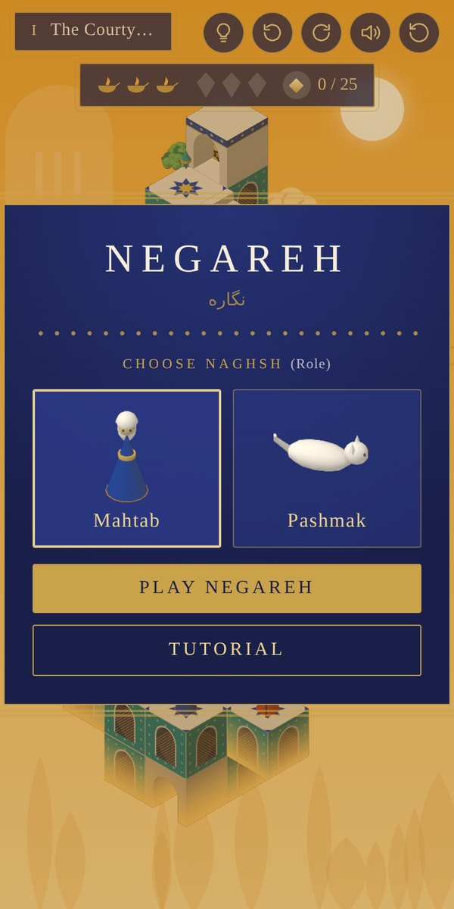
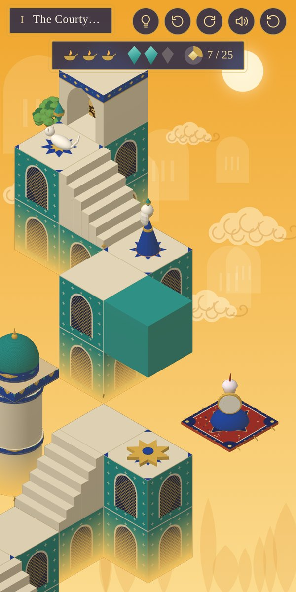
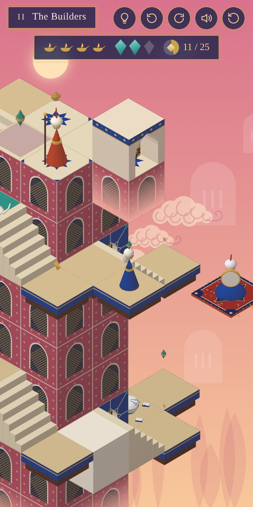
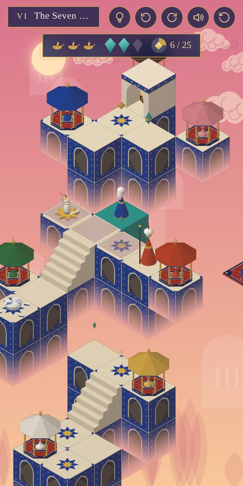
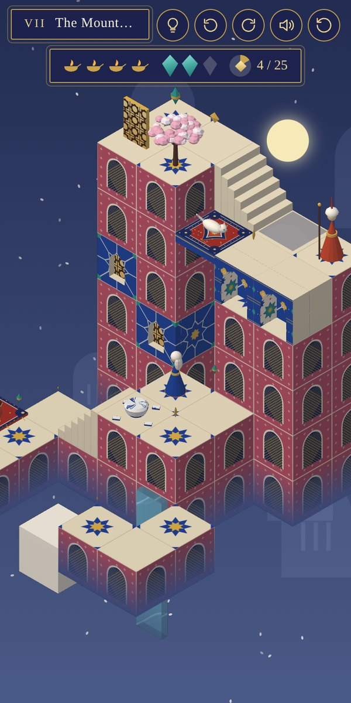
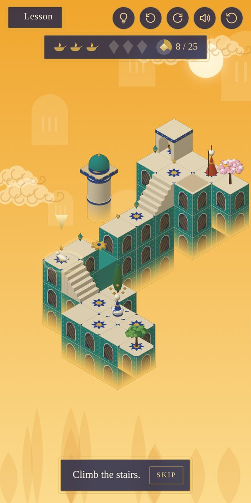

# Negareh

A Monument Valley–style puzzle game in which Persian miniature paintings become the levels. You play as Mahtab or Pashmak the white cat. Each chapter asks you to gather three shards of a broken cup while avoiding the guards, and with each shard another musician joins the music.

<p align="center">
  
  
  
</p>
<p align="center">
  
  
  
</p>

**Play it:** https://claude.ai/artifact/6y8uMLVj7KkN8LaqYfNeHw

The game is a single HTML file: plain JavaScript and WebGL, with no libraries and no build tools apart from Python.

## Build and test

```sh
python3 build.py                 # writes dist/negareh.html and dist/scene-builder.html
python3 tests/playthrough.py     # plays the tutorial and all 7 chapters headlessly; prints PASS or FAIL
```

To view the game, open `dist/negareh.html` in a browser. The test script needs Playwright: `pip install playwright && python3 -m playwright install chromium`.

`dist/` is not committed. Every change is made in `src/` and then built.

## Where things live

| File | What's in it |
|---|---|
| `src/engine.js` | WebGL renderer, procedural textures, the geometry builder, palettes |
| `src/art.js` | Painted pieces: walls, stairs, domes, trees, characters, musicians |
| `src/shell.html` | Page, HUD, cards (start screen, chapter titles, end screen), CSS |
| `src/game/01-look.js` | Game-only pieces, chapter palettes, tile patterns |
| `src/game/02-levels.js` | **The seven chapters**, the tutorial page and the tutorial steps |
| `src/game/03-world.js` | Game state, walk graph, level loading, walking, lifts, falling and turning stones |
| `src/game/04-guards-cat-hud.js` | Guards, the cat guide, lives, gifts, HUD |
| `src/game/05-sound-music.js` | **Sound and music** (Persian modes, santur, tar, daf, ney layers) |
| `src/game/06-render-camera.js` | Drawing each frame, background, camera director, tutorial marker |
| `src/game/07-input-flow.js` | Taps, buttons, chapter flow, start-up |
| `tools/scene-builder.src.html` | The 3D scene builder app |
| `tools/scenes/` | Example scene (The Hanging Garden) |
| `tools/screenshots.py` | Retakes the README screenshots in `docs/screenshots/` |

The files in `src/game/` are joined in number order inside one closure, so a later file can use anything defined in an earlier one.

## Working together without overwriting each other

1. **Split the work by file.** Agree on who owns which files for a while. One example: one person takes levels and art (`02-levels.js`, `art.js`, `01-look.js`), the other takes music and the tutorial (`05-sound-music.js`, plus the tutorial part of `02-levels.js`). Two people editing different files never conflict.
2. **One branch per change.** Run `git switch -c music-dastgah-tweaks`, commit, push, and open a pull request. GitHub shows any overlap before it is merged.
3. **Keep `main` working.** Before merging, run `python3 build.py && python3 tests/playthrough.py` and make sure it prints PASS.
4. **One publisher.** The shared game link is a Claude artifact owned by Kimia. After a merge she pulls `main`, builds, and asks Claude to publish `dist/negareh.html` to the existing Negareh link. Two people publishing to the same link would overwrite each other, because a publish replaces the whole page.

### Working through Claude

Each of you can hand this repo to your own Claude session. A good opening message:

> Clone github.com/Kimiafarah/naghsh-o-negar, create a branch called `<topic>`, and work only in `<files>`. When you're done, run `python3 build.py` and `python3 tests/playthrough.py`, then commit and push the branch and open a pull request.

A Claude session has its own copy of the files. Work only reaches the other person once it is pushed to GitHub.
